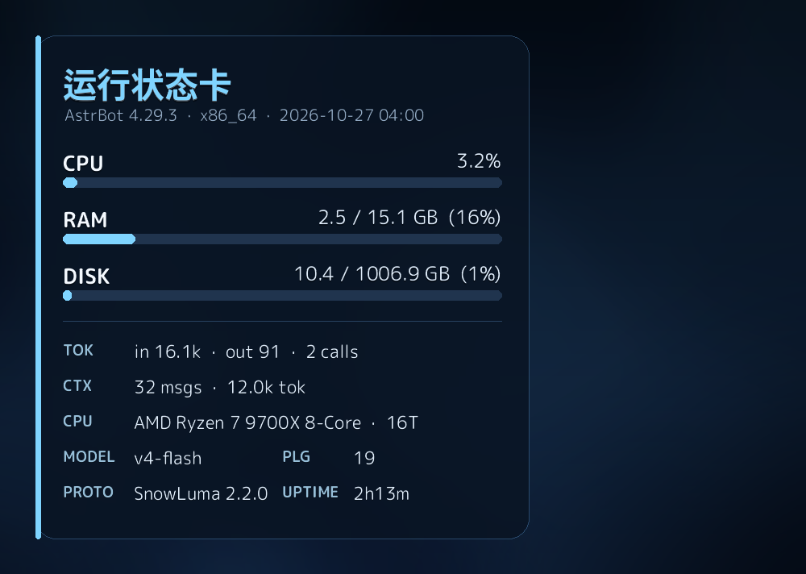

<div align="center">

# 运行状态卡

**一条 `状态` 指令，回一张整幅插画背景的系统状态卡。**

CPU / RAM / DISK 进度条、token 消耗、会话上下文、CPU 型号、模型、协议端版本，全叠在磨砂面板上。纯本地 Pillow 渲染，不依赖浏览器或渲染服务。

[](LICENSE)
[](https://github.com/AstrBotDevs/AstrBot)
[](https://www.python.org/)
[](#兼容性)

</div>



## 功能

- **资源进度条**：CPU / RAM / DISK 三条，填充长度即百分比，颜色分级 `<60%` 冰蓝、`60~85%` 橙、`>85%` 红
- **token 与经济性**：今日 in / out token 与调用次数（读 AstrBot 自身数据库，只读）
- **会话上下文**：当前会话消息条数与 token 规模，方便判断上下文压得够不够
- **硬件与运行时**：CPU 型号 + 线程数、AstrBot 版本与架构、运行时长、插件数、对话模型、协议端名称与版本
- **随机背景**：`assets/bg/` 里放几张图，每次指令随机挑一张；也可固定某一张
- **字段全可开关**：不想要的指标在面板里关掉，对应行自动消失，不会留空
- **自动降级**：字体缺失 / 绘图异常 / 发图失败 → 自动回退纯文本，不会没反应

## 兼容性

| 项目 | 说明 |
|---|---|
| AstrBot | >= 4.0.0 |
| Python | 3.10+（AstrBot 官方镜像已带 Pillow / psutil） |
| 平台 | `aiocqhttp`（OneBot v11） |
| 协议端 | SnowLuma / NapCat / 其它 OneBot v11 实现，自动探测地址与令牌 |
| 渲染 | 纯本地 Pillow，无需 t2i / playwright / 外部服务 |

## 安装

**方式一：手动**

把整个目录放到 AstrBot 的插件目录后重启：

```
<AstrBot 数据目录>/plugins/astrbot_plugin_sl_status/
```

**方式二：git clone**

```bash
cd <AstrBot 数据目录>/plugins
git clone <本仓库地址> astrbot_plugin_sl_status
```

日志出现 `Plugin astrbot_plugin_sl_status (v2.1.0) by 小喷菇` 即加载成功。

## 必要配置

**无。** 装上即可用：默认随机背景、全部字段显示、协议端自动探测。

## 主要配置

AstrBot 面板 → 插件 → 运行状态卡 → 配置。

### 输出

| 键 | 类型 | 默认 | 说明 |
|---|---|---|---|
| `send_image` | bool | `true` | 关掉只发纯文本 |
| `title` | string | `运行状态卡` | 卡片标题 |

### 背景

| 键 | 可选值 | 默认 | 说明 |
|---|---|---|---|
| `bg_mode` | `random` / `fixed` | `random` | 随机换图 / 固定一张 |
| `bg_fixed` | 文件名 | 空 | 固定模式下用哪张；留空用目录第一张 |

### 字段显隐

| 键 | 默认 | 控制 |
|---|---|---|
| `show_cpu` / `show_ram` / `show_disk` | `true` | 三条进度条 |
| `show_tokens` | `true` | TOK：今日 token |
| `show_context` | `true` | CTX：会话上下文 |
| `show_cpu_model` | `true` | CPU 型号 + 线程 |
| `show_model` | `true` | MODEL：对话模型 |
| `show_plugins` | `true` | PLG：插件数 |
| `show_protocol` | `true` | PROTO：协议端 |
| `show_uptime` | `true` | UPTIME：运行时长 |

### 协议端（一般不用填）

| 键 | 默认 | 说明 |
|---|---|---|
| `api_base` | 空 | OneBot HTTP 地址，留空自动探测 |
| `access_token` | 空 | 访问令牌，一般用环境变量传 |

## 管理与指令

| 指令 | 别名 | 权限 | 说明 |
|---|---|---|---|
| `状态` | `sl`、`st`、`运行状态` | 所有人 | 生成状态卡 |
| `状态图` | `slbg` | 管理员 | 列出可用背景图与当前背景模式 |

群里需带唤醒前缀（`#` 或 `/`）或 @ 机器人；私聊直接发。

## 工作方式

1. **采集**：CPU 读 cgroup `cpu.stat` 的 `usage_usec` 差值（容器里 `psutil.cpu_percent` 首次恒为 0）；内存读 cgroup `memory.current` / `memory.max`（容器 `/proc/meminfo` 是被裁剪的）；磁盘用 `psutil.disk_usage("/")`
2. **统计**：token 与上下文从 AstrBot 数据库 `provider_stats` / `conversations` 聚合，`mode=ro` 只读打开
3. **探测协议端**：`get_version_info` + `get_status`，按环境变量 → 配置 → 常见容器地址顺序尝试，401 直接跳下一个，成功地址会被缓存
4. **绘制**：背景 cover 裁剪 → 面板区高斯模糊后压深 → 三条进度条 → 文字（暗影 + 正文两层），1000×712 PNG
5. **发送**：`event.image_result()`；任何一步失败都回退纯文本

排版：信息区显式分行、行距固定 44px，内容多时先缩字号再压行距（下限 34px），不会两行贴在一起；标签白色加粗、数值白色常规，靠字重分主次。

## 换背景

1. 把图片放进 `assets/bg/`，支持 `.png` / `.jpg` / `.jpeg` / `.webp`，可放任意多张
2. `bg_mode = random`（默认）：每次指令随机一张
3. `bg_mode = fixed` + `bg_fixed = 文件名`：固定某一张

图片建议横图、比例接近 1000:712（如 1216×832）；主体偏右下、左侧留暗部，因为信息面板压在左边。代码按 cover 等比裁剪，不会变形。

自带一张中性深蓝渐变默认图，删掉也不影响——没有可用图片时会退回纯色底。

## 排错

| 现象 | 处理 |
|---|---|
| `PROTO` 显示未连接 | 协议端容器是否在跑；连不上是网络，401 是令牌 |
| 发文字不是图片 | 日志里看 `渲染状态卡失败` / `发送图片失败`，或 `send_image` 被关了 |
| CPU 一直 0.0% | 容器空闲时 cgroup 差值接近 0，正常 |
| 换图没生效 | 图在 `assets/bg/` 且后缀受支持；`fixed` 模式文件名要和 `bg_fixed` 完全一致 |

## 隐私

卡片只显示数值与版本号：不含 QQ 号、昵称、群号、好友列表、文件路径、主机名。所有指标本地读取，不外发；数据库只读打开，只做聚合。

## 许可证

- 本插件：**MIT**，见 [LICENSE](LICENSE)
- 内置圆体 **M PLUS Rounded 1c**：SIL OFL 1.1，见 [FONT-NOTICE.md](FONT-NOTICE.md)
- 标题字体 Noto Sans CJK 由 AstrBot 运行环境自带，本仓库不分发

## 更新日志

- **v2.1.0**：字段全部可开关、背景随机/固定、管理指令 `状态图`、默认标题通用化、输出文件名加随机串（并发不覆盖）
- **v2.0.0**：多背景支持、`_conf_schema.json` 面板配置、显示开关
- **v1.8.3**：标签改白色系，圆体 + 立体字效，全英文简写
- **v1.7.0**：信息区显式分行，修复文字重叠
- **v1.5.0**：整幅插画背景 + 叠字面板 + 进度条
